# Lead Extractor

[](LICENSE) [](https://github.com/alpotap/Lead-Extractor---Batch-LLM/commits/main) [](https://github.com/alpotap/Lead-Extractor---Batch-LLM) [](https://github.com/alpotap/Lead-Extractor---Batch-LLM/stargazers) [](https://github.com/alpotap/Lead-Extractor---Batch-LLM/issues) [ ](https://github.com/alpotap/Lead-Extractor---Batch-LLM)

A local-first lead extractor and manager for any businesses. No lengthy configurations

Extract data from webpages automatically - all you need is a URL!

# How does it work? (simple workflow)

1. Find the website of the business you want to add to your leads (for example if you find them on Google maps).
2. Copy the URLs to their "Contact Us" or "About" page.
3. Paste the URL in the tool. 
   The tool will process the data automatically, using your Ollama.
4. Use the data! The tool will find:
   **Contacts, emails, addresses, working hours, business definitions, links to socials** and assign **categories**.

[](https://youtu.be/svA6KY2tfQg)

You want a faster way? Read the detailed guide below

## Start the app (Fast start suitable for 99% users)

Requirement: have an Ollama (local and Cloud are supported)

1. Download **Lead-Extractor-Windows.zip** from the [GitHub Releases](https://github.com/alpotap/Lead-Extractor---Batch-LLM/releases) page.
   You can do this and skip to step 3
   ```git clone https://github.com/alpotap/Lead-Extractor---Batch-LLM```
2. Extract the zip it to a folder you can write to.
3. Double-click **Start Lead Desk.bat** inside the extracted folder.
   First time will take a couple of minutes. After this - 3 seconds to start.
4. Keep the launcher window open while using the app.
   If no python is found - it will install it automatically.
5. Your default browser will open the app automatically.
   Default: http://localhost:8501
6. Use the App!

Note: If Ollama is unavailable, you can still browse and edit existing company records, but the app cannot extract new leads until Ollama is running.

<!-- Screenshot: app setup and model selection -->

## How to use Lead Extractor

### 0. Setup

The app is ready to work immediately, but you can change a few things to make it more convenient.

1. Settings:
   
   1. Data location:
      
      1. Expand the left pane.
      
      2. Change the Lead data folder to a custom directory.
         After saving, the app will build the data structure automatically. If there is no folder it will be created.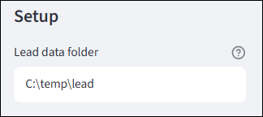
   
   2. Models:
      
      1. Local Ollama
         
         1. Change the model - they are auto discovered so you can select from the drop down.
            Note - you don't need a smart model. The tools is built to do simple tasks so no thinking is required. (Save your tokens for other things).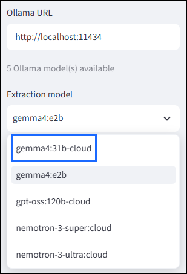
         
         2. Change the URL if he Ollama client is installed elsewhere.
            You will have the option to add an API key but its not required.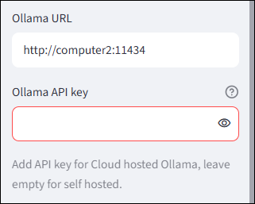
         
         3. Official Cloud Ollama service:
            
            1. Set the Cloud Ollama URL to https://ollama.com/
            
            2. Set your API key. Note - the API key is not stored securely, the app is intended to be used locally and not exposed to users of the internet.
               The app saves it in config/secrets.json
            
            3. Enter the model name.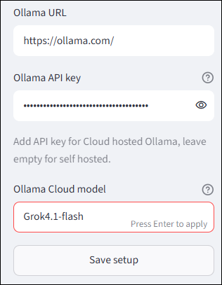
         
         4. Save settings.
         
         5. Collapse the left pane.

2. Add and use categories
   The app figures out and assigns categories automatically based on context of your inputs.
   
   1. Open the **Categories** tab to manage categories and subcategories.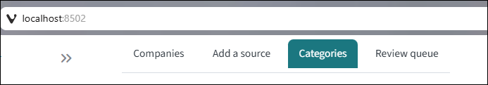
   
   2. To create a new main category, enter its name. To add subcategories to an existing category, choose it from **Add subcategories to**. You can paste multiple subcategories, one per line.
   
   3. Select **Save categories**. The category tree is saved in `LeadData/categories.json` and is available when editing company records and during future Ollama extractions.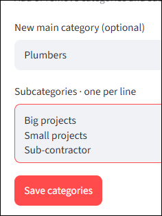
      
      3. To remove a category, choose it under **Delete a category or subcategory** and select **Delete category**. 
         This also removes its subcategories from future choices. To remove only one subcategory, select its parent and child, then select **Delete subcategory**.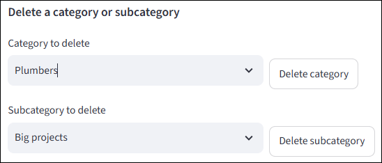
* Removing a category or subcategory only changes the taxonomy offered for new work. Existing company records keep their assigned category and subcategory; the old value remains available on that company’s edit form. Re-adding a built-in category makes it available again.

* A fresh install starts without preset categories; unassigned category values display as `—` until you add categories.

### 1. Add source material

There are 3 ways to add source material
NOTE: if you add multiple sources for the same company - all details will be merged. 

1. From URL (Slow because you do one at a time)
   The tool downloads the HTML file and processes it automatically. There is a 10 second cooldown to let the page load before its is downloaded.
   
   1. Navigate to **Add a source**
   
   2. Select **Fetch from URL**
   
   3. Paste the URL of a business into the **Company page URL**
   
   4. Press **Fetch page and save HTML**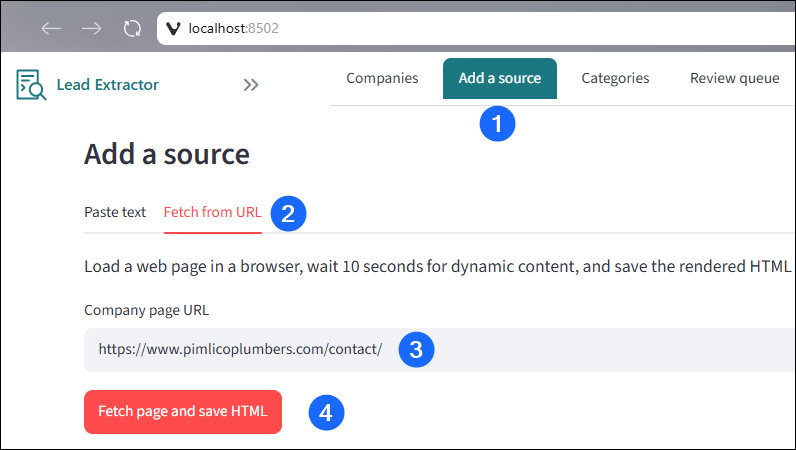

2. HTML files (Fast because you do a lot at once)
   You save a bunch of html files, the tool processes them in the background. Benchmark - 20 pages a minute
   
   1. Find the page you want to use for Lead extraction
   
   2. Press ctrl+s and select the ```<lead data folder>\ingest\incoming``` as destination
   
   3. Press enter to save
   
   4. Now every time you find a new page you just press ctrl+s and enter - all files will go into ingestion (you are limited by how fast your fingers move)
   
   5. The tool will process the files and add
      Demo:
      

3. You can view page source and copy paste the text manually into the app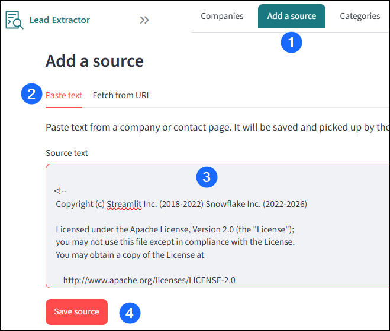
* The scanner checks the incoming folder every 1 minute. Keep the app running while you wait. It records the selected model and source filename in the processing logs.

<!-- Screenshot: Companies and Add a source tabs -->

<!-- Screenshot: original HTML beside its parsed TXT file -->

### 2. Find and review extracted companies

1. Open **Companies** to browse the company list. Use the search field to find a company, contact, email, or phone.
2. Click a company name to open its details.
3. Review and edit company fields, contacts, social accounts, opening hours, and notes. Contacts are individual rows with a name, role, emails, and phones. Social accounts pair a platform name with a profile URL.
4. Click **Save company changes** after editing company information.
   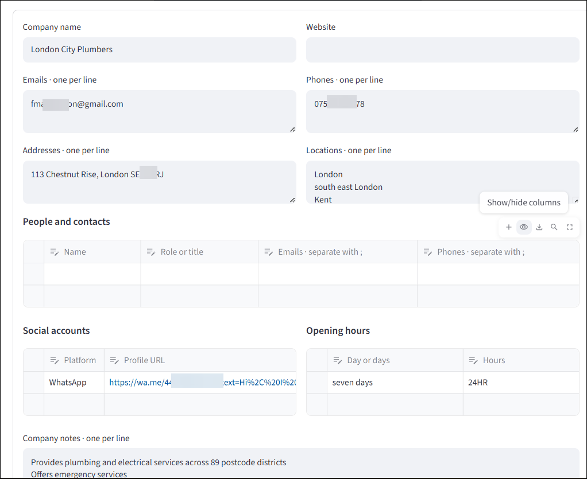
5. Use the follow-up controls to update status, rating, last-contacted date, and next follow-up date. Add follow-up notes as separate entries; edit or delete an individual note with its controls.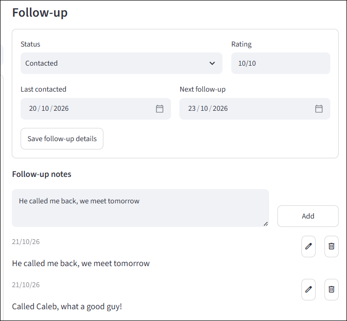
6. Use **Copy as JSON** when you explicitly want a copy of the current company record in your clipboard and use it in some other tool
7. Use **Archive** on a company record to hide it from the default company list. Archived companies remain available for duplicate matching when new sources are processed. Expand **Advanced search** and turn on **Show archived** to find or restore one.

<!-- Screenshot: company details and follow-up controls -->

#### Pro tips:

- it is faster to save a bunch of html files and then copy them to your destination folder. This way you can separate tasks: open pages, save them, copy them. Benchamark - I got leads saved on ~50 site (90 pages) in about 5 minutes.
- HTML as a source is better than getting the page content with Ctrl+a. The HTML will include links to socials
- If the business has a separate page for business hours, save it too. The tool merges all data under the same business so you can have multiple pages to enrich a single entry.

<!-- Screenshot: category and subcategory manager -->

## More detail

See [detailed procedures, merging behavior, the UK publisher example, and data/log details](REFERENCE.md).

## macOS and Linux

- [macOS package and setup](docs/MACOS.md)
- [Linux package and setup](docs/LINUX.md)
